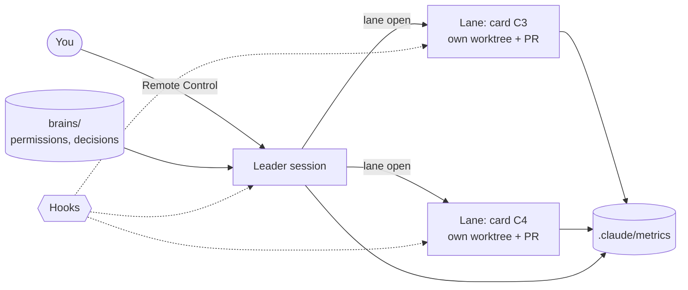

# AgiAgentKit

English · [Tiếng Việt](README.vi.md)

Run many Claude Code sessions at once without babysitting each one.

AgiAgentKit's core feature is **Session Superadvisor**: one Claude Code session acts as the **leader** and opens
**lane** sessions in `tmux`, one per backlog card, each in its own git worktree with its own PR. You talk only to the
leader, from the terminal or your phone, and approve only merges, production and permissions.

A small Claude Code plugin backs it:

- **Five agents pinned to a model tier.** Cheap models read, mid-tier models write, strong models judge.
- **Six hooks.** Four stop common token sinks and owner-only actions; two record token usage.
- **A scorecard** of what the main session and each subagent actually spent.

## Quick start

You need Claude Code, `git`, `tmux` and `jq` on macOS or Linux. The full walkthrough is in
[docs/INSTALL.md](docs/INSTALL.md).

```bash
git clone https://github.com/trungungtoan-agilityio/AgiAgentKit.git
```

```bash
claude plugin marketplace add ./AgiAgentKit
```

```bash
claude plugin install agi-agent-kit@agi-agent-kit
```

```bash
AgiAgentKit/bin/superadvisor init /path/to/your-project
```

```bash
AgiAgentKit/bin/superadvisor up /path/to/your-project
```

Then open the leader session (`tmux -L sa attach -t YOUR-PROJECT-LEAD`, or Remote Control in the Claude app) and give
it work: *"Read BACKLOG.md, size each card, open a lane for C3 and C4."* (The leader does the small cards itself; C3 and C4 are the medium ones.)

## How it works



| Role | Does | Never does |
|------|------|------------|
| **You** | Decide product; approve merges, production, permissions | Hand-feed work to each lane |
| **Leader** | Sizes the backlog, writes briefs, opens lanes, unblocks them, reports in 5 lines | Write large blocks of code itself |
| **Lane** | One card, one worktree, one PR | Merge, push to `main`/`master`/`dev`, edit settings (the `owner-guard` hook blocks it) |
| **Brains** | `brains/` folder: the leader's permissions, decisions and inbox | Act on its own |

| Agent | Model | Used for |
|-------|-------|----------|
| `scout` | Haiku | Read-only lookups: find files, symbols, call sites |
| `builder` | Sonnet | Known-cause changes across 1–5 files |
| `tester` | Sonnet | Writing and fixing tests |
| `debugger` | Opus | Unknown root cause, or a builder that failed twice |
| `reviewer` | Opus | One read-only review before a PR |

Hook thresholds, metrics and every CLI command are in [docs/reference.md](docs/reference.md). The design is in
[docs/architecture.md](docs/architecture.md).

Slides from the Agility IO talk: [PDF](docs/talk/Session-Superadvisor-AgilityIO.pdf) ·
[PowerPoint](docs/talk/Session-Superadvisor-AgilityIO.pptx).

## Docs

- [Install guide](docs/INSTALL.md)
- [Architecture](docs/architecture.md)
- [Lifecycle of one card](docs/lifecycle.md)
- [FAQ](docs/faq.md)
- [Reference](docs/reference.md)
- [One-page explainer](docs/explainer.html) (open the file in a browser)
- [Step-by-step visual lesson](docs/lesson.html) (open the file in a browser)
- [Atlas: eight isometric views](docs/atlas.html) (open the file in a browser)
- [Talk documents](docs/talk/README.md): handout (English), Q&A sheet and CLI cheat sheet (Vietnamese); HTML, open in a browser
- [Benchmark results](bench/results.md)
- [Benchmark](bench/README.md)

## Try the demo

`demo-app/` is a small "library loans" service with a six-card backlog, from small fixes to one hard bug. These
commands assume the kit is cloned to `~/AgiAgentKit`.

```bash
cp -R ~/AgiAgentKit/demo-app ~/demo-library && cd ~/demo-library && git init -q && git add -A && git commit -qm init && npm install
```

```bash
~/AgiAgentKit/bin/superadvisor init ~/demo-library
```

```bash
~/AgiAgentKit/bin/superadvisor up ~/demo-library
```

Watch the lanes with `superadvisor status`. Flag stuck ones with `superadvisor patrol`, and close merged idle ones
with `superadvisor patrol --clean --apply`. End the day with `superadvisor review` and start it with
`superadvisor report`; `superadvisor cron --install` schedules all three. To compare runs with and without the leader, see [bench/README.md](bench/README.md); the latest numbers are in [bench/results.md](bench/results.md).

## Good to know

- Skill and hook messages are in Vietnamese; the commands and file names are in English.
- Hooks save tokens; they are not a security boundary. Without `jq` they let everything through.
- Costs in the scorecard are estimates from a price table, not your bill.
- Remote Control needs a claude.ai login.

## Development

```bash
scripts/test-all.sh
```

`scripts/package.sh` builds a zip of the committed files. License: [MIT](LICENSE).
