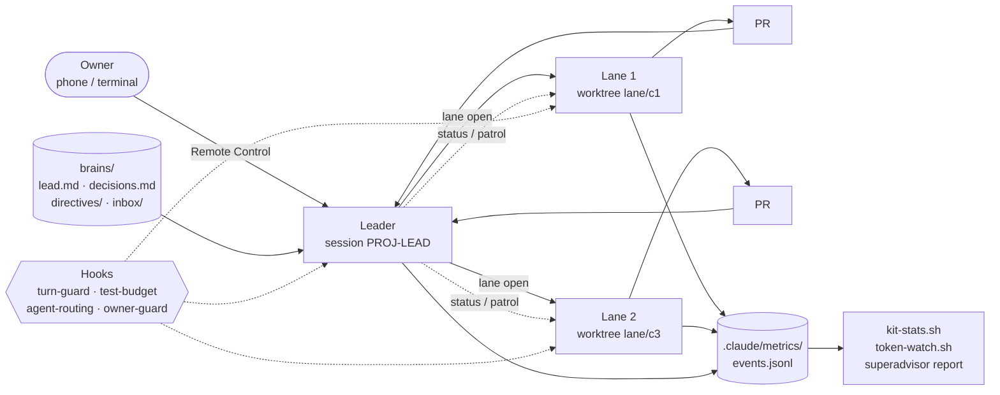
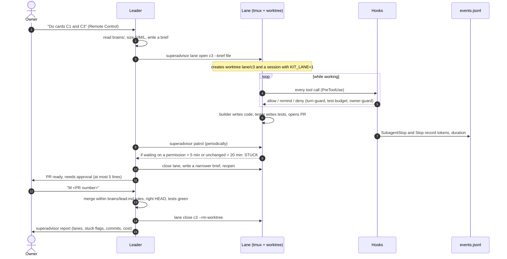

# AgiAgentKit architecture

English · [Tiếng Việt](architecture.vi.md)

Two separate parts: the **`bin/superadvisor` CLI** (tmux + worktree orchestration, no dependency on the plugin) and
the **`plugin/`** (agents, hooks, metrics scripts, the `lead` skill). `template/` is what `superadvisor init` copies
into a project: rules, `brains/` and a `CLAUDE.md` block.

## Component diagram

| Component | Where | Role |
|-----------|-------|------|
| Leader | tmux socket `sa`, session `<PROJ>-LEAD` | Coordinates; reads `brains/`, uses the `lead` skill |
| Lane | session `<PROJ>-<NAME>`, worktree `lane/<name>`, env `KIT_LANE=1` | Does exactly one brief, opens one PR |
| Brains | `brains/` (in git) and `brains/.local/` (not in git) | Permissions, decisions, directives, briefs, patrol log |
| Hooks | `plugin/hooks/` | Stop token waste, keep lanes off owner-only work, record metrics |
| Metrics | `.claude/metrics/events.jsonl` in the main checkout | Data source for `kit-stats.sh`, `token-watch.sh`, `report` |

## One card, step by step

Notes per step:

- **`lane open`** checks the name (a-z, 0-9, hyphen), copies the brief into `brains/.local/briefs/`, creates the
  worktree and branch `lane/<name>` (reused if it already exists), then opens a tmux session with `KIT_LANE=1`,
  `KIT_LANE_NAME`, `KIT_LANE_BRIEF`. With no `--model`, the lane runs on Claude Code's default model; the `lead` skill
  tells the leader to use sonnet and pick opus only when a card needs judgement. `--dry-run` prints the commands
  without running them.
- **Hooks** run inside the lane's own session. `owner-guard` only acts when `KIT_LANE=1` and always **denies** (there
  is nobody to ask); the other blocking hooks **deny** in auto mode and **ask** in other modes.
- **Metrics** are written to the main checkout (not the worktree), so they survive when the worktree is removed.
  Metrics hooks never block: on error they exit quietly.
- **`patrol`** reads the tmux state (BUSY / IDLE / WAITING / DEAD), compares it with `patrol.waiting_min` and
  `patrol.stuck_min` in `brains/config.json`, and writes `brains/.local/patrol.log`. `superadvisor cron` prints
  samples for running it on a schedule.
- **Merge** by default happens only when the owner says so; the minimum is green tests on the exact HEAD and no
  High/Critical findings left after at most 2 review rounds. Releases, deploys and permission changes are outside the
  leader's authority.

## Design decisions

- **Hooks save tokens; they are not security.** Without `jq` they let everything through; the goal is to stop
  token-burning habits, not to stop an attacker.
- **Model tier by kind of work**, pinned in the agent frontmatter; `agent-routing` blocks model overrides.
- **A thin leader.** It does not write heavy code and does not read large files; that goes to a lane or to `scout`, so
  the leader's context (the most expensive item, because it lives longest) stays small and cheap.
- **One card = one worktree = one PR**, so parallel lanes do not step on each other's files and each PR can be
  reviewed on its own.
- **Runtime data stays out of git**: `.claude/metrics/` and `brains/.local/` are git-ignored.
