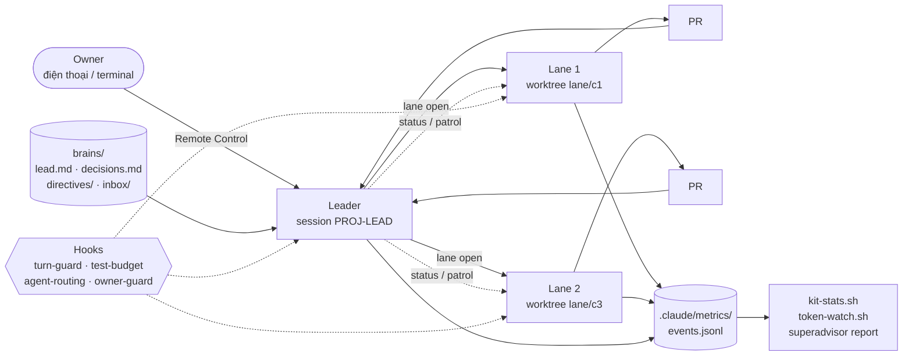
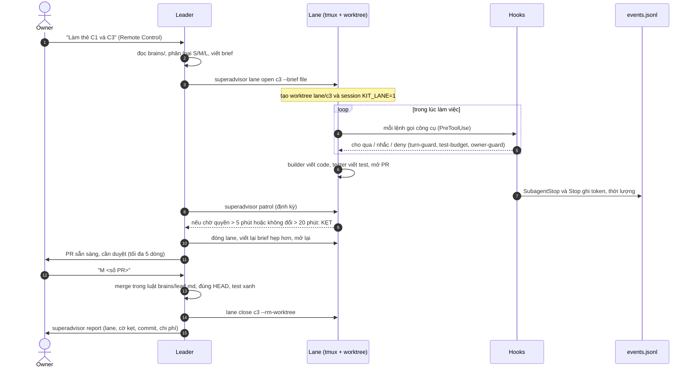

# Kiến trúc AgiAgentKit

[English](architecture.md) · Tiếng Việt

Hai phần tách bạch: **CLI `bin/superadvisor`** (điều phối tmux + worktree, không phụ thuộc plugin) và **plugin
`plugin/`** (agent, hook, script đo, skill `lead`). `template/` là phần chép vào project bằng
`superadvisor init`: rules, `brains/` và khối `CLAUDE.md`.

## Sơ đồ thành phần

| Thành phần | Ở đâu | Vai trò |
|------------|-------|---------|
| Leader | tmux socket `sa`, session `<PROJ>-LEAD` | Điều phối; đọc `brains/`, dùng skill `lead` |
| Lane | session `<PROJ>-<TÊN>`, worktree `lane/<tên>`, env `KIT_LANE=1` | Làm đúng một brief, mở một PR |
| Brains | `brains/` (git) và `brains/.local/` (không vào git) | Quyền, quyết định, chỉ thị, brief, nhật ký patrol |
| Hooks | `plugin/hooks/` | Chặn lãng phí token, giữ lane khỏi việc của owner, ghi số đo |
| Metrics | `.claude/metrics/events.jsonl` ở checkout chính | Nguồn dữ liệu cho `kit-stats.sh`, `token-watch.sh`, `report` |

## Tuần tự một thẻ việc

Ghi chú cho từng bước:

- **`lane open`** kiểm tên (a-z, 0-9, gạch ngang), chép brief vào `brains/.local/briefs/`, tạo worktree và nhánh
  `lane/<tên>` (dùng lại nếu đã có), rồi mở session tmux với `KIT_LANE=1`, `KIT_LANE_NAME`, `KIT_LANE_BRIEF`. Model
  mặc định là sonnet; `--model` để đổi. `--dry-run` in lệnh mà không chạy.
- **Hook** chạy trong chính session của lane. `owner-guard` chỉ hoạt động khi `KIT_LANE=1` và luôn **deny** (không có
  ai để hỏi); các hook còn lại **deny** ở auto mode và **ask** ở chế độ khác.
- **Số đo** ghi về checkout chính (không phải worktree) nên còn nguyên sau khi worktree bị xoá. Hook đo không bao giờ
  chặn: lỗi thì thoát im lặng.
- **`patrol`** đọc trạng thái tmux (BUSY / IDLE / WAITING / DEAD), so với ngưỡng `patrol.waiting_min` và
  `patrol.stuck_min` trong `brains/config.json`, ghi `brains/.local/patrol.log`. `superadvisor cron` in mẫu để chạy
  định kỳ.
- **Merge** mặc định chỉ khi owner nói rõ; điều kiện tối thiểu là test xanh trên đúng HEAD và không còn High/Critical
  sau tối đa 2 vòng review. Phát hành, deploy, đổi quyền không nằm trong quyền của leader.

## Quyết định thiết kế

- **Hook chỉ để tiết kiệm, không phải bảo mật.** Thiếu `jq` thì cho qua; mục tiêu là chặn thói quen đốt token, không
  chặn kẻ xấu.
- **Phân tầng model theo loại việc**, ghim trong frontmatter agent; `agent-routing` chặn việc đè model.
- **Leader mỏng.** Nó không tự code nặng và không đọc file lớn; việc đó giao lane hoặc `scout`, để ngữ cảnh của
  leader (khoản đắt nhất, vì sống lâu) nhỏ và rẻ.
- **Một thẻ = một worktree = một PR**, nên lane song song không giẫm file của nhau và mỗi PR review được độc lập.
- **Dữ liệu chạy máy ngoài git**: `.claude/metrics/` và `brains/.local/` nằm trong `.gitignore`.
